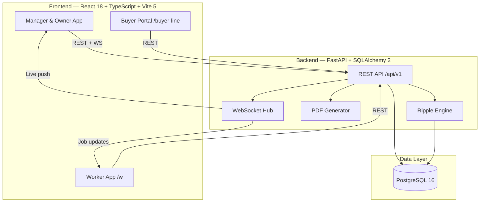
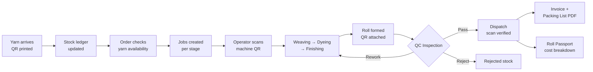
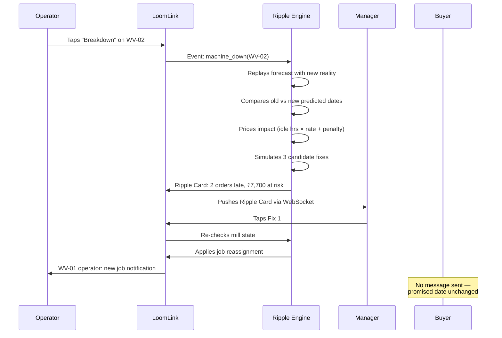
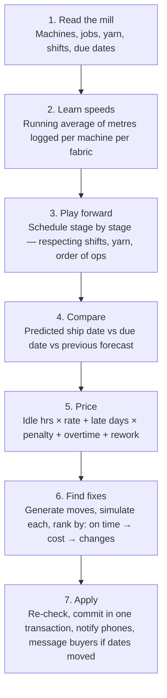

# LoomLink — The Mill That Sees Ahead

> A QR-traced textile manufacturing platform with a live consequence engine that turns every event on the factory floor into its impact on orders, buyers, and rupees — and the best fix.

<br/>

## Why We Built This

Everest Textile Mills runs on notebooks, paper slips, and phone calls. When a loom breaks at 11:20 AM, the manager still has to work out in his head which orders are now late, which buyer to call, and what it will cost. That mental arithmetic is exactly where delays, idle time, and hidden cost accumulate.

Most systems fix the *recording* problem — stock screens, machine screens, QC forms. We fixed the *consequence* problem. LoomLink doesn't just show you what happened. It shows you what it means, what it will cost, and what to do next — in under a second.

---

## The Two Layers

```
┌─────────────────────────────────────────────────────────────┐
│  LAYER 1 — LoomLink Core (The Present)                      │
│  QR backbone: every yarn batch, machine and fabric roll      │
│  gets an identity. Workers scan instead of writing.          │
│  Stock, production, QC, dispatch, attendance, money —        │
│  one database, one source of truth.                          │
└─────────────────────────────────────────────────────────────┘
                           +
┌─────────────────────────────────────────────────────────────┐
│  LAYER 2 — Ripple (The Future and the Money)                 │
│  A live forecast of the entire mill. Recomputes the moment  │
│  anything changes. Every breakdown, shortage, or QC fail     │
│  becomes a Ripple Card: affected orders, ₹ at risk, and      │
│  three tested fixes. One tap applies the fix.                │
└─────────────────────────────────────────────────────────────┘
```

---

## The Signature Moment

In our demo we break a loom. A ripple spreads across the floor map from the broken machine to two orders, which turn red. A Ripple Card shows "2 orders late, ₹7,700 at risk" and three ranked fixes. The manager taps one. The orders turn green, the next operator's phone shows his new job, and the owner's Leak Meter records what the breakdown really cost.

**Fifteen seconds. No phone call. No walk.**

---

## System Architecture



---

## Data Flow — From Yarn to Invoice



---

## The Ripple Loop



---

## Module Overview

| Module | Route | Who uses it |
|--------|-------|-------------|
| Dashboard | `/app/dashboard` | Owner, Manager |
| Floor View (live) | `/app/floor` | Manager, Supervisor |
| Orders | `/app/orders` | Manager, Accounts |
| Inventory | `/app/inventory` | Storekeeper |
| Production | `/app/production` | Supervisor, Operators |
| Quality Control | `/app/quality` | QC Inspector |
| Dispatch | `/app/dispatch` | Dispatch Clerk |
| Workers & Payroll | `/app/workers` | Manager, Accounts |
| Finance | `/app/finance` | Accounts, Owner |
| **Ripple Inbox** | `/app/ripple` | Manager |
| **Leak Meter** | `/app/leak` | Owner |
| Worker App (PIN login) | `/w` | All floor workers |
| Buyer Portal | `/buyer-line` | Buyers |

---

## Ripple — How It Thinks

The engine runs in 7 steps, completing in milliseconds for a mill of this size:



---

## The Five Faces of Ripple

| Feature | Who sees it | What it answers |
|---------|-------------|-----------------|
| **Promise Date** | Sales, Owner | "Earliest realistic ship date for this new order?" |
| **Order Health** | Everyone | Green / amber / red — hours of slack before the due date |
| **Ripple Card** | Manager | Which orders moved, ₹ at risk, three simulated fixes |
| **Idle Hunter** | Supervisor | "WV-01 is free and can absorb ORD-107 which is at risk" |
| **Leak Meter** | Owner | Money lost today to idle time, rework, waste, overtime — live |

---

## The Roll Passport

Every roll carries its full life story. Scan any roll to see:

```
ROLL-104-07  ·  98 m  ·  Blue Cotton Poplin  ·  Kaveri Garments, ORD-104
───────────────────────────────────────────────────────────────────────────
Yarn       Batch YB-2610-03, Vel Spinners, received 2 Oct, 14 kg used
Weaving    WV-01, operator Ravi, 10 Oct, Shift A
Dyeing     DY-02, dye lot DL-55, 11 Oct
Quality    Passed 12 Oct · 1 minor defect at 41 m
───────────────────────────────────────────────────────────────────────────
Cost       Yarn ₹6,860 + Weaving ₹1,170 + Dyeing ₹1,470 + QC ₹180
           + Overhead ₹520  =  ₹10,200  (₹104 per metre)
Margin     98 m × ₹125 = ₹12,250  →  ₹2,050 margin  (16.7%)
───────────────────────────────────────────────────────────────────────────
```

This answers the brief's headline question: *"Nobody knows the real cost of a single roll."*

---

## Tech Stack

| Layer | Technology | Why |
|-------|-----------|-----|
| Frontend | React 18 + TypeScript + Vite 5 | Fast build, typed, phone-friendly |
| Styling | Tailwind CSS 3.4 + dark mode | Works on any screen, any light condition |
| State | TanStack Query | Server-state sync with optimistic updates |
| i18n | i18next | Tamil, Telugu, Hindi, English — worker's choice |
| Backend | FastAPI + Python 3.12 | Typed, async, same language as Ripple engine |
| ORM | SQLAlchemy 2 + Alembic | Reliable migrations, typed queries |
| Database | PostgreSQL 16 | ACID transactions for stock and money |
| Live updates | WebSockets | Floor map and Ripple Cards push instantly |
| PDFs | ReportLab 4 | Packing lists, payslips, GST invoices |
| QR scanning | html5-qrcode | Browser camera — no app install needed |
| Auth | JWT + PIN login | Full login for managers; PIN-only for floor workers |
| Testing | pytest + Playwright | Backend unit + E2E |
| Deploy | Docker Compose | One command; runs on a local PC or cloud |

---

## Storage Conventions

Everything is stored in exact integer units — no floats, no rounding surprises:

| Concept | Unit | Why |
|---------|------|-----|
| Money | BIGINT paise (÷100 = ₹) | Exact arithmetic, GST-safe |
| Yarn | INTEGER grams | Precise to the gram |
| Fabric | INTEGER centimetres | No floating metres |
| Durations | INTEGER minutes | Clean shift maths |
| Time | UTC timestamptz via `app.core.time.now()` | Supports `DEMO_CLOCK_START` override |

---

## Quick Start

```bash
# 1. Clone and start all services
git clone https://github.com/sredharanshankar/LoomLink.git
cd LoomLink
docker compose up -d

# 2. Wait ~10 seconds for the database, then seed demo data
docker compose exec api python -m app.seed.run --scenario

# 3. Open in your browser
open http://localhost:5173
```

---

## Demo Accounts

| Role | Employee Code | Password | PIN |
|------|--------------|----------|-----|
| Owner | `OWN-001` | `demo1234` | `100001` |
| Manager | `MGR-001` | `demo1234` | `200002` |
| Storekeeper | `STK-001` | `demo1234` | `300003` |
| QC Inspector | `QCI-001` | `demo1234` | `500005` |
| Dispatch | `DSP-001` | `demo1234` | `600006` |
| Accounts | `ACC-001` | `demo1234` | `700007` |
| Floor Operator | `EMP-001` to `EMP-012` | — | `400004` |
| Buyer (demo) | `BYR-001` | `demo1234` | — |

> Floor operators log in with PIN only — no password needed, big buttons, their language.

---

## Development Setup

**Backend**

```bash
cd backend
pip install -r requirements.txt
alembic upgrade head
uvicorn app.main:app --reload
```

**Frontend**

```bash
cd frontend
npm install
npm run dev
```

**Run all tests**

```bash
# Backend unit tests
cd backend && pytest

# Frontend type check
cd frontend && npm run typecheck

# E2E tests
cd frontend && npx playwright test
```

**Regenerate API types after backend changes**

```bash
make gen-api
# or on Windows:
./scripts/dev.ps1 gen-api
```

---

## Environment Variables

| Variable | Default | Purpose |
|----------|---------|---------|
| `DATABASE_URL` | `postgresql+psycopg://loomlink:loomlink@db:5432/loomlink` | DB connection |
| `JWT_SECRET` | *(required)* | Token signing key |
| `DEMO_CLOCK_START` | *(empty = real time)* | Freeze the clock for demos |
| `VITE_API_BASE` | `/api/v1` | Frontend API base URL |
| `VITE_MOCK_MODULES` | *(empty)* | Comma-separated modules to mock in dev |

Copy `.env.example` in the frontend folder and fill in your values.

---

## Project Structure

```
LoomLink/
├── backend/
│   ├── app/
│   │   ├── api/v1/          # FastAPI routers (one file per domain)
│   │   ├── services/        # Business logic layer
│   │   ├── models/          # SQLAlchemy ORM models
│   │   ├── ripple_service/  # Ripple engine: forecast, fixes, pricing
│   │   ├── pdf/             # ReportLab PDF generators
│   │   ├── core/            # Auth, errors, events, audit, time
│   │   └── seed/            # Demo data seeding
│   ├── alembic/             # Database migrations
│   └── tests/               # pytest suite
├── frontend/
│   ├── src/
│   │   ├── features/        # Feature-sliced pages (orders, quality, ripple…)
│   │   ├── components/      # Shared UI components
│   │   ├── lib/             # API client, auth, formatting, dark mode
│   │   ├── locales/         # en / hi / ta / te translations
│   │   └── mocks/           # MSW handlers for development
│   └── tests/e2e/           # Playwright end-to-end tests
├── docs/                    # CONTRACT, RBAC, SEED, OWNERSHIP, CONCEPT
└── docker-compose.yml
```

---

## RBAC — Who Can Do What

Permissions are checked on every API call. The key roles:

| Role | Can do |
|------|--------|
| `owner` | Everything, including finance costs and month close |
| `manager` | Orders, production, dispatch, workers, Ripple fixes |
| `storekeeper` | Inventory receive, issue, purchase orders |
| `operator` | Start/log/finish jobs on assigned machines |
| `qc_inspector` | Inspect rolls, log defects, pass/rework/reject |
| `dispatch` | Create dispatches, scan rolls, confirm |
| `accounts` | Finance, invoices, payments, payroll |
| `buyer` | Own orders only — no costs, no worker data |

---

## Before and After — A Day at Everest

| Scene | Today | With LoomLink |
|-------|-------|--------------|
| Yarn arrives | Written in a notebook | Batch received, QR printed, stock updated in 60 seconds |
| New order deadline | Owner guesses a date | Promise Date computed from real stock, queues, and machine speeds |
| Production floor | Supervisor walks the floor | Live floor map, progress in metres, shift handover |
| Loom breakdown | Discovered when a buyer complains | Ripple Card in 1 second: affected orders, ₹ at risk, 3 fixes |
| Checking fabric | Paper slip | Scan roll → tap defect → pass/rework/reject. Full traceability. |
| Buyer calls | Walk, ask, call back later | Buyer opens tracking link or sends an SMS — answered instantly |
| Loading the truck | Counted by hand | Scan each roll. Wrong buyer? Blocked. Already dispatched? Blocked. |
| Owner closes the books | Separate registers | Month profit on one screen. Leak Meter shows where it escaped. |

---

## Team

| Name | Role |
|------|------|
| **Sredharan Shankar** | Backend core, infrastructure, database, APIs, docs |
| **Gugan S S** | Ripple engine, BoL voice interface, Buyer Line |
| **Dilip Dhanasekar** | Frontend, UX, worker app, dark mode, floor view |

---

## Licence

MIT — see [LICENSE](LICENSE)

---

<p align="center">
  <em>"Every other system tells Everest what happened.<br/>
  LoomLink tells them what it means — and what to do next."</em>
</p>
